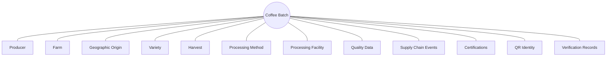
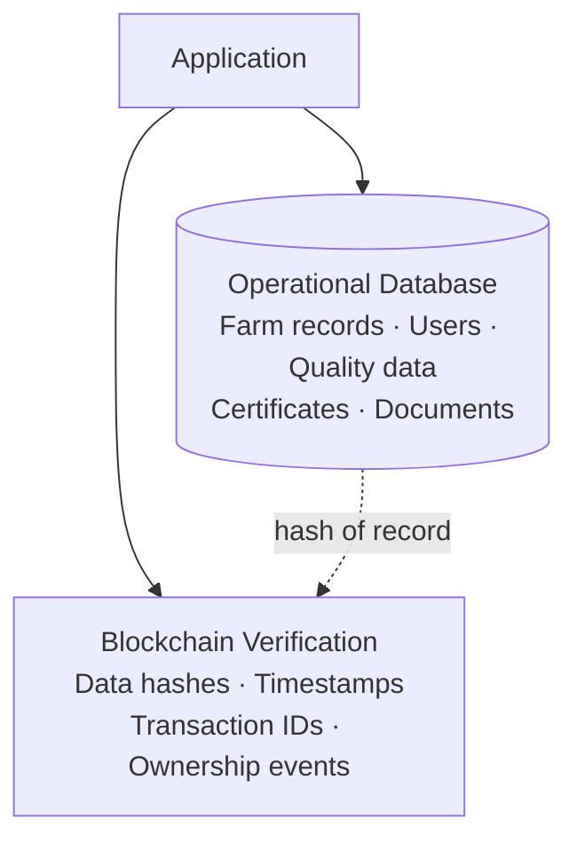
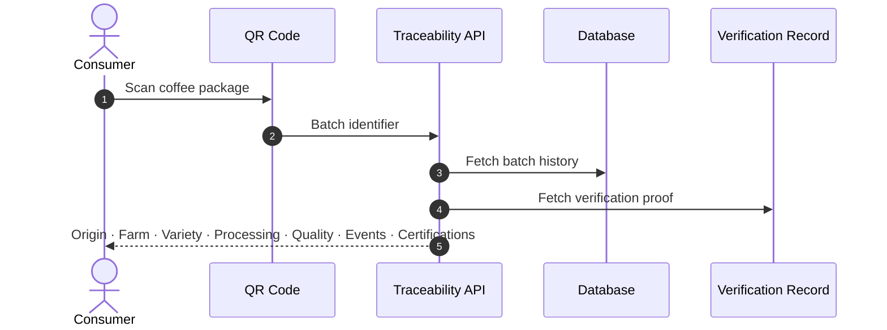
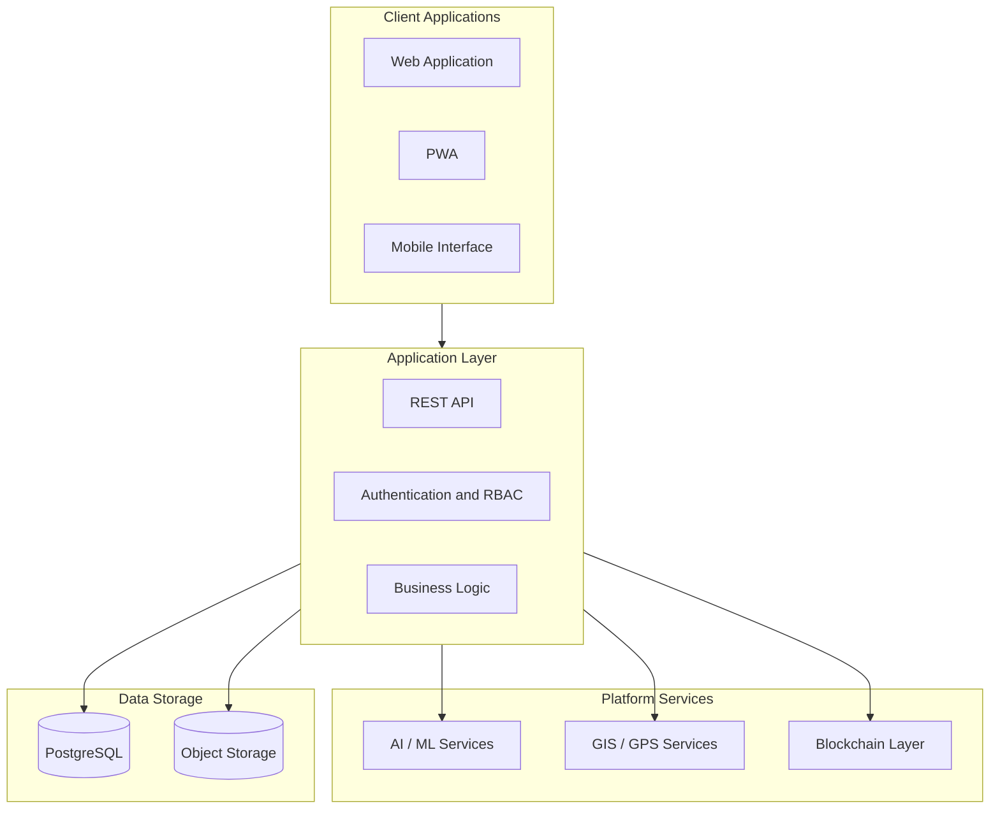
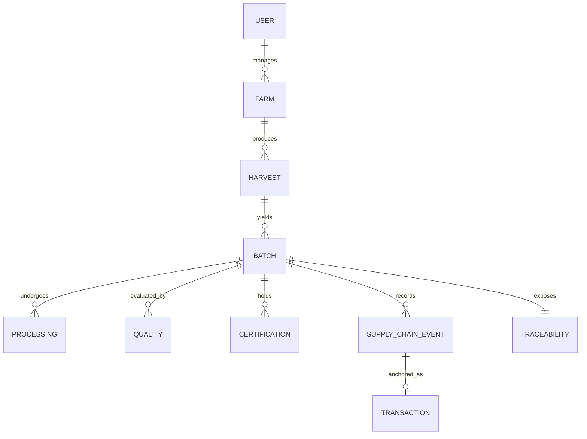
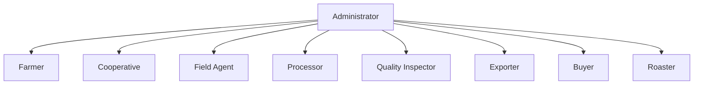
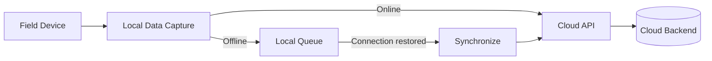

<div align="center">


<a href="#">
  
</a>

<br/><br/>


**[Vision](#-vision)** · **[Platform Modules](#-platform-modules)** · **[Architecture](#-system-architecture)** · **[Blockchain Layer](#-blockchain-verification-layer)** · **[Roadmap](#-roadmap)** · **[Status](#-project-status)**

</div>

---

## 🎯 Vision

A coffee batch passes through producers, washing stations, cooperatives, exporters, logistics providers, importers, buyers and roasters before it reaches a cup. Each actor keeps its own records, and the history rarely survives the journey.

The **Global Coffee Traceability Platform** is a full-stack engineering project that creates a **unified digital layer** across that chain. It gives every batch a durable digital identity that preserves origin, production history, processing data, quality results and custody events, and makes them verifiable.


### Engineering Principles

| Principle | Meaning |
|---|---|
| **Transparency** | Trace coffee across its full lifecycle |
| **Integrity** | Maintain reliable, historical records |
| **Accessibility** | Support international, multilingual users |
| **Intelligence** | Turn operational data into insight |
| **Scalability** | Design for multiple regions and organizations |
| **Interoperability** | Integrate cleanly with external systems |

---

## 🧩 Platform Modules

<table>
<tr>
<td width="33%" valign="top">

### 🌱 Farm Management
Farmers, farms, cooperatives, GPS, altitude, harvest seasons, varieties and production history. **The farm is the first digital node of the chain.**

</td>
<td width="33%" valign="top">

### 🔎 Traceability Engine
Unique batch identity linked to producer, origin, processing, quality, events, certifications, QR identity and verification records.

</td>
<td width="33%" valign="top">

### ⛓️ Blockchain Verification
Hash-anchored, independently verifiable events for integrity-sensitive steps in the chain.

</td>
</tr>
<tr>
<td valign="top">

### 📱 QR Traceability
Scan the coffee, understand its origin, follow its journey through a public traceability endpoint.

</td>
<td valign="top">

### 🏭 Processing and Cooperatives
Member management, washing stations, intake, lot creation, grading, cupping records and production aggregation.

</td>
<td valign="top">

### 🗺️ Geospatial Intelligence
Map farms, producers, washing stations, cooperatives, regions and supply-chain locations.

</td>
</tr>
<tr>
<td valign="top">

### 🤖 AI and Agricultural Intelligence
Crop-health analysis, disease-detection support, yield analysis, forecasting and anomaly detection.

</td>
<td valign="top">

### 📊 Analytics and Decision Support
Production, quality, logistics, sustainability and geographic dashboards for every stakeholder.

</td>
<td valign="top">

### 🤝 Specialty Coffee and B2B
Producer-buyer connections, market information, coffee events, education and digital sourcing workflows.

</td>
</tr>
</table>

---

## 🔎 Traceability Model

Each batch is the center of a connected record graph.



**Reporting flow:** `ORIGIN → HARVEST → PROCESSING → QUALITY → EXPORT → LOGISTICS → BUYER → ROASTER → MARKET`

---

## ⛓️ Blockchain Verification Layer

Blockchain here is a **verification layer, not a replacement for the operational database.** Large operational datasets stay in conventional storage, and only integrity-sensitive events are anchored for independent verification.



<details>
<summary><b>Candidate on-chain events</b></summary>

<br/>

```text
CREATE_BATCH             REGISTER_PROCESSING      TRANSFER_CUSTODY
REGISTER_EXPORT          REGISTER_QUALITY_RESULT  REGISTER_ROASTING
VERIFY_BATCH
```

</details>

---

## 📱 QR Traceability Flow



---

## 🏗️ System Architecture



---

## 🗃️ Domain Data Model



---

## 🔐 Identity, Authentication and Authorization

Multi-role access control, where each actor gets permissions matched to its responsibility in the chain.



**Designed capabilities:** registration · authentication · email verification · password recovery · session management · role-based access control · protected routes · authorization checks · secure API access

---

## 🌍 Internationalization

| 🇬🇧 English | 🇮🇹 Italian | 🇪🇹 Amharic | 🌐 Future locales |
|---|---|---|---|
| `en` | `it` | `am` | Added through translation keys, with no redesign of core functionality |

---

## 📡 Offline-First Field Architecture

Agricultural environments cannot assume permanent connectivity.



**Targets:** responsive interface · mobile-first workflows · PWA architecture · offline data collection · post-reconnect sync · field-friendly UX

---

## 🛠️ Engineering Stack

> The stack represents the current and targeted architecture and will evolve as development progresses.

| Layer | Technologies |
|---|---|
| **Frontend** | React · Next.js · TypeScript · Tailwind CSS |
| **Backend** | Node.js · Express · REST APIs · Python services |
| **Data** | PostgreSQL · NoSQL / document storage · Cloud object storage |
| **AI / Computer Vision** | Python · TensorFlow · PyTorch · OpenCV |
| **Geospatial** | Google Maps · Mapbox · OpenStreetMap · GeoJSON · GPS |
| **Distributed Verification** | Blockchain · Smart contracts · Transaction verification · Data hashing |
| **Infrastructure** | Cloud deployment · Containerized services · Environment-based config · Object storage · CDN · CI/CD |

---

## 🗂️ Repository Structure

<details>
<summary><b>Target monorepo layout</b></summary>

<br/>

```text
global-coffee-traceability/
├── apps/
│   ├── web/
│   └── api/
├── packages/
│   ├── ui/
│   ├── database/
│   ├── blockchain/
│   ├── i18n/
│   └── shared/
├── services/
│   └── ai/
├── contracts/
├── docs/
│   ├── architecture/
│   ├── api/
│   └── database/
├── public/
├── tests/
├── .github/
│   └── workflows/
├── README.md
├── LICENSE
└── package.json
```

</details>

---

## 🧭 Roadmap

```mermaid
gantt
    title Development Phases
    dateFormat  X
    axisFormat  Phase %s
    section Foundation
    01 Platform Foundation       :active, p1, 0, 1
    section Persistence
    02 Persistent Application    :p2, 1, 2
    section Core Engine
    03 Traceability Engine       :p3, 2, 3
    section Verification
    04 Blockchain Layer          :p4, 3, 4
    section Intelligence
    05 Intelligent Agriculture   :p5, 4, 5
    section Production
    06 Production Engineering    :p6, 5, 6
```



<details>
<summary><b>Phase 01 · Platform Foundation</b></summary>

<br/>

- [ ] Application interface
- [ ] Traceability center design
- [ ] Farm-management interface
- [ ] Processing workflows
- [ ] Operational mapping interface
- [ ] Analytics interface
- [ ] B2B concepts
- [ ] Internationalization foundation

</details>

<details>
<summary><b>Phase 02 · Persistent Application Layer</b></summary>

<br/>

- [ ] Production database
- [ ] Replace demonstration data
- [ ] Create / Read / Update / Delete operations
- [ ] Persistent farm registration
- [ ] Persistent producer records
- [ ] Persistent coffee batches
- [ ] Dynamic dashboards
- [ ] Production authentication

</details>

<details>
<summary><b>Phase 03 · Traceability Engine</b></summary>

<br/>

- [ ] Supply-chain event engine
- [ ] Dynamic batch histories
- [ ] QR generation
- [ ] Public traceability endpoint
- [ ] Quality-data integration
- [ ] Document verification

</details>

<details>
<summary><b>Phase 04 · Blockchain Layer</b></summary>

<br/>

- [ ] Smart-contract architecture
- [ ] Batch registration
- [ ] Supply-chain transaction records
- [ ] Data hashing
- [ ] Transaction verification
- [ ] Blockchain explorer integration

</details>

<details>
<summary><b>Phase 05 · Intelligent Agriculture</b></summary>

<br/>

- [ ] Crop analysis services
- [ ] Disease-detection workflow
- [ ] Predictive production analytics
- [ ] Intelligent recommendations
- [ ] AI-assisted reports

</details>

<details>
<summary><b>Phase 06 · Production Engineering</b></summary>

<br/>

- [ ] Automated testing
- [ ] CI/CD pipeline
- [ ] Monitoring
- [ ] Logging
- [ ] Security hardening
- [ ] Performance optimization
- [ ] Offline synchronization
- [ ] Production deployment

</details>

---

## 🚧 Project Status

| | |
|---|---|
| **Status** | Active development |
| **Type** | Full-stack software engineering project |
| **Domain** | AgTech · Coffee · Supply chain |
| **Focus** | Traceability · Intelligence · Transparency |
| **Architecture** | Web + Cloud + AI + GIS + Blockchain |

> Some interfaces and architectural concepts are already implemented. Database persistence, production authentication, blockchain functionality, AI services and infrastructure are being developed progressively. This repository documents both implemented functionality and the engineering roadmap toward a production-oriented system.

---

## 🎯 Engineering Objectives

- Improve farm-to-market traceability and build reliable digital coffee identities
- Digitize agricultural and processing records
- Increase supply-chain transparency and support data-driven decisions
- Enable geographic visibility
- Explore verifiable supply-chain records
- Apply AI to agricultural information
- Support multilingual, international users
- Design for field environments with limited connectivity

---

## 🤝 Contributing

Contributions, technical discussions, research collaboration and ideas are welcome.


---

## 👨‍💻 Developer

<div align="center">

### Simon Wolde Balango

**Computer Engineer · Software Developer · Technology Builder**

Building at the intersection of
**Software Engineering · Artificial Intelligence · Blockchain · Agriculture · Data Engineering · Global Supply Chains**

<br/>

> *Every coffee has an origin. Every batch has a journey.*
> *Engineering can make that journey transparent, intelligent and verifiable.*

<br/>

<a href="#">
  
</a>

</div>


